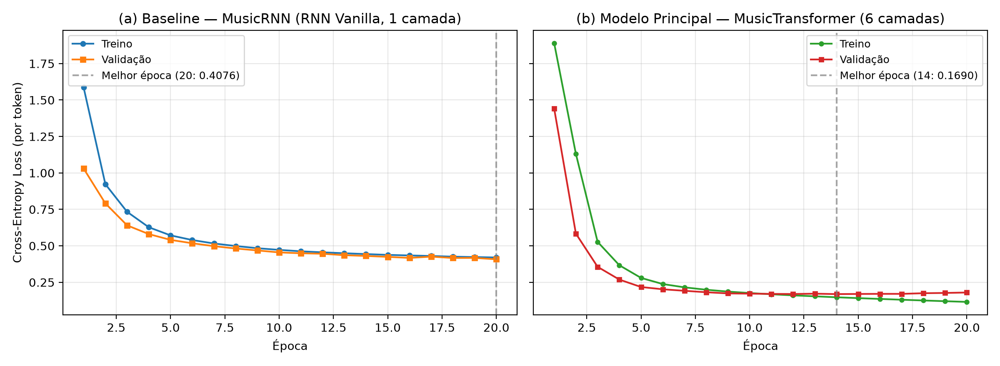
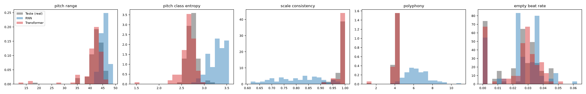

# Geração Musical Simbólica Autoregressiva no Dataset Nottingham — RNN vs. Transformer

**Projeto Final — DCC831: IA Generativa para Música (UFMG, 2026/2)**

Este repositório contém o código-fonte, resultados objetivos, gráficos e amostras musicais (MIDI e áudio sintetizado `.wav`) do projeto final de geração musical simbólica incondicional utilizando redes neurais autoregressivas implementadas nativamente em PyTorch.

---

## 1. Visão Geral do Projeto

- **Tarefa:** Composição musical simbólica incondicional (polifônica — melodia + acompanhamento de acordes).
- **Dataset:** [Nottingham Music Database (`jukedeck/nottingham-dataset`)](https://github.com/jukedeck/nottingham-dataset), filtrado exclusivamente para as **1.034 composições completas** da pasta `MIDI/` (descartando as subpastas redundantes `melody/` e `chords/` para evitar *data leakage*).
- **Partições (por música, `SEED = 42`):** 80% treino (827 músicas), 10% validação (103 músicas) e 10% teste (104 músicas).
- **Representação:** `MIDI-Like` via `miditok` com `pitch_range=(36, 89)` (vocabulário de **429 tokens**, preservando 100% da tessitura `36–88` do corpus, incluindo os baixos dos acordes).
- **Pré-processamento compartilhado:** *data augmentation* por transposição cromática (`-2` a `+2` semitons) restrito ao conjunto de treino + janelamento deslizante (*sliding window*) com `WINDOW_SIZE = 1024`, `STRIDE = 512` e `BATCH_SIZE = 32`.
- **Modelos (implementação nativa em PyTorch):**
  - **Baseline (`MusicRNN`):** RNN *vanilla* (Elman `nn.RNN` com `tanh`) de 1 camada (`embedding_dim=64`, `hidden_dim=128`, ~108 mil parâmetros).
  - **Modelo Principal (`MusicTransformer`):** Transformer *decoder-only* causal Pre-LN de 6 camadas (`d_model=256`, `nhead=8`, `dim_feedforward=1024`, `GELU`, *weight tying* e inicialização estilo GPT-2), treinado com `AdamW` (grupos com/sem *weight decay*), `OneCycleLR` e *Early Stopping*.
- **Amostragem:** temperatura, *top-k* e *top-p* (*nucleus sampling*), utilizando `temperature=0.95`, `top_k=40` e `top_p=0.95` na avaliação comparativa (100 amostras por sistema).

---

## 2. Estrutura do Repositório

```text
.
├── DCC831_Nottingham_Projeto_Final.ipynb        # Notebook completo pronto para Google Colab (GPU + FluidSynth)
├── DCC831_Nottingham_Projeto_Final_Local.ipynb  # Versão executada localmente (Windows + RTX 5070) com todos os outputs salvos
├── requirements.txt                             # Dependências Python
├── results/
│   ├── perplexity_test.csv                      # Cross-Entropy e Perplexidade no conjunto de teste
│   ├── metrics_comparison.csv                   # Comparação completa (Média ± DP, |Δ|, Overlap Area, KL)
│   ├── training_curves.png                      # Curvas de treino e validação (MusicRNN vs. MusicTransformer)
│   └── metric_distributions.png                 # Histogramas das 5 métricas objetivas (Teste vs. RNN vs. Transformer)
└── samples/
    ├── baseline_rnn/                            # 5 arquivos MIDI + 5 áudios .wav gerados pelo baseline (MusicRNN)
    └── modelo_transformer/                      # 5 arquivos MIDI + 5 áudios .wav gerados pelo MusicTransformer
```

---

## 3. Como Instalar e Reproduzir os Resultados

### Opção A — Google Colab (recomendado)
1. Faça o upload de `DCC831_Nottingham_Projeto_Final.ipynb` para o [Google Colab](https://colab.research.google.com/).
2. Ative o acelerador de hardware em **Ambiente de execução → Alterar tipo de ambiente de execução → GPU (T4 ou superior)**.
3. Execute todas as células em ordem (**Ambiente de execução → Executar tudo**). O notebook baixa automaticamente o dataset, tokeniza, treina os dois modelos, gera as curvas, avalia as 100 amostras por modelo no conjunto de teste e sintetiza os arquivos `.wav` com FluidSynth.

### Opção B — Execução Local (Python 3.12+)
```bash
git clone https://github.com/GiacominF/Projeto_Final_IA_Generativa.git
cd Projeto_Final_IA_Generativa

python -m venv .venv
# Windows (PowerShell):
.\.venv\Scripts\Activate.ps1
# Linux / macOS:
# source .venv/bin/activate

pip install -r requirements.txt
```
*(Opcional para GPU NVIDIA CUDA: instale o PyTorch com o índice CUDA correspondente à sua placa, ex.: `pip install torch --index-url https://download.pytorch.org/whl/cu128`.)*

Em seguida, abra `DCC831_Nottingham_Projeto_Final_Local.ipynb` no Jupyter / VS Code e execute as células sequencialmente.

---

## 4. Resumo dos Resultados

### Perplexidade no Conjunto de Teste (104 músicas)

| Modelo | Cross-Entropy (Teste) | Perplexidade (Teste) |
| :--- | :---: | :---: |
| **MusicRNN (Baseline)** | `0.3845` | `1.469` |
| **MusicTransformer** | **`0.1281`** | **`1.137`** |

### Avaliação Objetiva das Distribuições (100 amostras por modelo — Yang & Lerch, 2020)

| Métrica | Teste (real) | MusicRNN (Baseline) | MusicTransformer | OA RNN | **OA Transformer** | KL RNN | **KL Transformer** |
| :--- | :---: | :---: | :---: | :---: | :---: | :---: | :---: |
| **Pitch Range** | `42.69 ± 3.46` | `45.84 ± 1.49` | `41.20 ± 5.54` | `0.497` | **`0.875`** | `4.963` | **`0.224`** |
| **Pitch Class Entropy** | `2.729 ± 0.118` | `3.281 ± 0.187` | `2.637 ± 0.180` | `0.088` | **`0.702`** | `12.248` | **`0.741`** |
| **Scale Consistency** | `0.986 ± 0.021` | `0.806 ± 0.093` | `0.991 ± 0.017` | `0.129` | **`0.768`** | `13.805` | **`0.879`** |
| **Polyphony** | `4.104 ± 0.333` | `6.376 ± 1.253` | `4.058 ± 0.557` | `0.040` | **`0.905`** | `3.314` | **`0.040`** |
| **Empty Beat Rate** | `0.023 ± 0.015` | `0.026 ± 0.014` | `0.024 ± 0.014` | `0.516` | **`0.766`** | `2.838` | **`1.660`** |




---

## 5. Músicas Geradas (MIDI e Áudio)

As 5 amostras de cada sistema (em MIDI e áudio `.wav` sintetizado) estão disponíveis na pasta [`samples/`](samples/):

- **Baseline (`MusicRNN`):** [`samples/baseline_rnn/`](samples/baseline_rnn/) (`rnn_000` a `rnn_004`, `.mid` e `.wav`)
- **Modelo Principal (`MusicTransformer`):** [`samples/modelo_transformer/`](samples/modelo_transformer/) (`transformer_000` a `transformer_004`, `.mid` e `.wav`)

---

## 6. Contribuição dos Integrantes

- **Caio Jorge Carvalho Lara**: Coleta, validação, análise exploratória e filtragem das composições completas do dataset Nottingham, garantindo particionamento e tokenização `MIDILike` com reconstrução MIDI. Também estruturei a modelagem inicial do projeto e redigi as Seções 1 (Introdução), 2 (Trabalhos Relacionados) e 6 (Conclusão) do artigo no template.
- **Guilherme Giacomin**: Consolidação e unificação de janelamento deslizante compartilhado (WindowedMusicDataset), adição da amostragem com nucleus sampling (top-p), estudo experimental de sensibilidade de temperatura (T ∈ {0, 8; 0, 9; 1, 0}), e redação das Seções 3 (Método) e 4 (Experimentos) do artigo ISMIR e apoio na documentação do repositório (README.md e requirements.txt).
- **Victor Yuji [nome completo]:** Implementação da avaliação objetiva dos modelos, incluindo perplexidade no conjunto de teste, geração de 100 amostras por modelo, cálculo das métricas musicais (Pitch Range, Pitch Class Entropy, Scale Consistency, Polyphony e Empty Beat Rate) e comparação das distribuições com o corpus real via Overlap Area e divergência KL (Yang & Lerch, 2020). Também redigi a Seção [5 (Resultados)] do artigo ISMIR.
- **Integrante 3 (Nome completo):** *ex.: protocolo de avaliação objetiva (métricas, Overlap Area, KL), síntese de áudio, revisão e apresentação.*

---

## 7. Declaração de Uso de Ferramentas de IA

Em conformidade com as diretrizes da disciplina DCC831, declaramos o uso de ferramentas de IA generativa como apoio ao desenvolvimento do projeto:

- **Ferramentas utilizadas:** Google Antigravity (assistente de código e revisão técnica), Google Gemini (entendimento da proposta do trabalho e auxílio com latex para Overleaf).
- **Objetivos do uso:** revisão de diagnóstico de *data leakage* e pré-processamento, apoio na depuração de inicialização e otimização do Transformer, adaptação do notebook para execução local em GPU CUDA, verificação de métricas objetivas e apoio na revisão/estruturação do artigo e da documentação. Também foi utilizado Google Gemini para formatar parte desse arquivo README.
